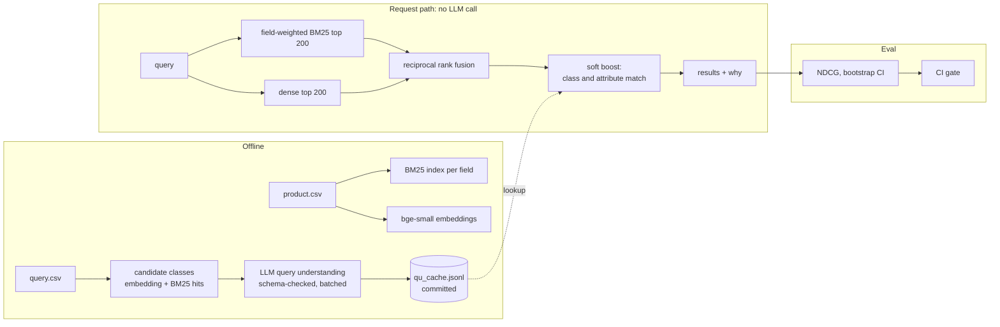

# wands-search

[](https://github.com/246mayank/wands-search/actions/workflows/ci.yml)

**Hybrid product search with offline LLM query understanding, evaluated on [WANDS](https://github.com/wayfair/WANDS), Wayfair's public product-search relevance dataset, with a CI gate that blocks relevance regressions.**

<!-- headline:start -->
<!-- headline:end -->

This is an offline evaluation on a public dataset: 42,994 products, 480 queries and 233,448 human labels. Nothing here is deployed or has seen real traffic.

## Results

The test split was run once, after tagging `freeze-v1`, with every row in this table run together. No tuning happened afterwards.

<!-- test_table:start -->
<!-- test_table:end -->

## The three questions

**1. How far does a well-tuned lexical and semantic baseline get?** Stemming and field weights move BM25 a long way, and adding dense retrieval with reciprocal rank fusion moves it further, because the two fail on different queries. See [BM25](#lexical-baselines) and [fusion](#dense-retrieval-and-fusion).

**2. Does LLM query understanding add relevance, and on which queries?** Yes on this dataset, as a soft boost. The test row above gives the size. On dev it helps most on category-browse queries, where a predicted class separates the right kind of product from lookalikes, and it hurts a little on a few classes such as End Tables and Wall Art. See [the breakdown](results/qu_breakdown_dev.md). A hard filter does worse, because a wrong class removes correct products for good.

**3. How well does an LLM relevance judge agree with the human labels?** Moderately to substantially, see [below](#an-llm-relevance-judge). It rarely confuses Exact with Irrelevant, and it is more generous than annotators, who also saw product images. It is used only to estimate how much scoring unjudged results as 0 understates a ranking. It replaces no human label.

**Three things that didn't work, reported as nulls.** An MS MARCO cross-encoder, a popularity prior and LLM query rewriting all failed to beat the final pipeline on dev. Learning to rank tied it. [ADR 004](docs/adr/004-final-pipeline.md) has the reasons, and [the prompt changelog](prompts/CHANGELOG.md) records a prompt revision that didn't help either.

## How it works



**The LLM never runs in the request path.** It runs offline over the query set, and each answer must pass a strict schema and name classes from that query's candidate list. Answers are committed in `cache/qu_cache.jsonl`. Online, a query that isn't in the cache gets no boost and a reason code. So latency doesn't depend on the LLM, and CI needs no API key. See [ADR 003](docs/adr/003-soft-boost-offline-llm.md).

**Stages are objects composed from YAML.** Each stage implements one `Retriever` protocol (`search(query, k) -> list[Hit]`), and `configs/*.yaml` compose them, so every result row names a config and a commit.

```yaml
# configs/hybrid_qu.yaml
pipeline:
  type: qu_boost          # QUBooster(inner=...)
  mode: soft
  model: gemini-3.5-flash-lite
  prompt: v1
  inner: {type: ref, path: configs/hybrid_rrf.yaml, name: hybrid_rrf}
```

## Evaluation design

The harness came first, and the split was committed before any tuning.

| Decision | Choice |
|---|---|
| Primary metric | NDCG@10 with Exact = 2, Partial = 1, Irrelevant = 0, linear gain, log2 discount |
| Secondary | Exact-only NDCG@10, MRR@10, Recall@100, capped Recall@100 |
| Unjudged products | Gain 0, with `judged@10` reported beside every score |
| Split | 320 dev / 160 test, seeded, stratified by `query_class` where a class is big enough: [`splits.json`](splits.json) |
| Significance | Paired bootstrap over queries, 10,000 resamples, 95% CI for every delta |
| Metric checks | Hand-computed cases, and a cross-check against `ranx` |
| Test discipline | The CLI refuses `--split test` unless `HEAD` carries the `freeze-v1` tag |

The data profile changed some of this, and [`docs/DATA_NOTES.md`](docs/DATA_NOTES.md) has the details. Some queries have no Exact label, so metrics that need one skip those queries rather than score them 0. Many queries have more relevant products than 100 results can hold, so plain Recall@100 can't reach 1 and a capped version sits beside it.

## Dev results

Dev numbers were used for tuning, so they are optimistic. The test table above is the claim.

### Lexical baselines

<!-- bm25:start -->
<!-- bm25:end -->

The weights came from a logged [324-row grid](results/bm25_grid_dev.csv). [ADR 001](docs/adr/001-field-weighting.md) explains the choices, including why this is field-weighted BM25 and not true BM25F, and how graded and Exact-only NDCG disagree.

### Dense retrieval and fusion

<!-- fusion:start -->
<!-- fusion:end -->

RRF ties the tuned weighted sum and has no parameter tuned on dev, so it stays. See [ADR 002](docs/adr/002-fusion.md).

### Query understanding

Measured directly first, against labelled query classes:

<!-- qu_scores:start -->
<!-- qu_scores:end -->

Many misses are noise in the labels rather than in the model, such as "camper" labelled Sheets And Sheet Sets. Then its effect on ranking:

<!-- qu_ranking:start -->
<!-- qu_ranking:end -->

### Reranking

<!-- rerank:start -->
<!-- rerank:end -->

MS MARCO models are trained on web passages, not product titles. Blended by RRF the model is noise, and on its own it hurts, so it isn't in the final pipeline.

### Latency

<!-- latency:start -->
<!-- latency:end -->

Reranking is timed even though the final pipeline omits it, to show what it would have cost.

### An LLM relevance judge

An extra experiment: can an LLM agree with the annotators? The rubric comes from WANDS's own annotation guidelines, and agreement is measured on labelled dev pairs sampled evenly across the three labels.

<!-- judge:start -->
<!-- judge:end -->

## The CI gate

[`eval-gate.yml`](.github/workflows/eval-gate.yml) runs `configs/final.yaml` on dev for every pull request and compares it with [`results/baseline.json`](results/baseline.json). A PR fails if dev NDCG@10 drops by more than 0.002, or if any fallback count rises.

Because LLM answers come from the committed cache, the gate is deterministic and costs nothing to run. Changing a prompt changes the cache key, so answers go missing, the fallback count rises and the gate fails until someone re-records them on purpose with [`qu-record.yml`](.github/workflows/qu-record.yml), the only workflow that calls an LLM.

## Limitations

- **Offline only.** Human labels aren't business metrics. Click logs would need position-bias correction, interleaving or A/B tests, and WANDS has none of that.
- **One dataset,** with weights tuned to its label distribution.
- **Small test set.** 160 queries give wide intervals, so read the CIs before the means.
- **Unjudged products.** They score 0, which understates every system. The judge experiment estimates the size of that gap on dev.
- **Noisy gold classes.** Some `query_class` labels are odd, so QU accuracy is "vs labelled query classes".
- **The cache is the whole story for QU.** A query outside it gets no boost. Tail queries aren't served, and the test split's answers were recorded offline just like dev's.
- **LLM results are scoped** to their model, prompt version and split.
- **CPU latencies** on one laptop, one query at a time. They say nothing about load.
- **MS MARCO isn't product-domain.** A reranker trained on product data might do better; this says nothing about that.
- **Field-weighted BM25 isn't true BM25F,** and the hybrid has no ANN index, which 43K products don't need.

## Reproduce

Scores reproduce from the committed cache with no API key:

```bash
pip install -e ".[dev]"
wands data fetch
wands index
bash scripts/dev_tables.sh
```

`wands index` encodes every product, which took about ten minutes on a laptop CPU. `wands serve` starts the demo page at `http://127.0.0.1:8000`, with a "why this result" panel for each product.

## Repository

```
wands/           data, text, catalog, pipeline, retrievers/, qu/, rerank, ltr, judge, eval/, cli, api
configs/         every pipeline, as YAML
prompts/         every prompt version, and CHANGELOG.md
cache/           committed LLM answers and query vectors
results/         generated reports; never hand-edited
docs/            ADRs, DATA_NOTES, ERROR_ANALYSIS, AI_WORKFLOW
web/             the demo page
```

## Credits

Dataset: Chen, Liu, Liu, Sun, Baltrunas and Schroeder, *WANDS: Dataset for Product Search Relevance Assessment*, ECIR 2022, MIT licence. This project isn't affiliated with Wayfair.

Built with AI-assisted development (Claude Code). [`docs/AI_WORKFLOW.md`](docs/AI_WORKFLOW.md) records who did what, and each time a test or a metric caught a mistake the AI made.
