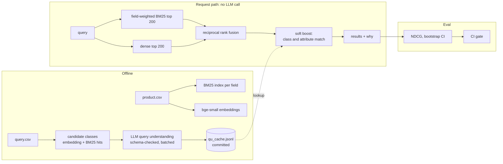

# wands-search

[](https://github.com/246mayank/wands-search/actions/workflows/ci.yml)

**Hybrid product search with offline LLM query understanding, evaluated on [WANDS](https://github.com/wayfair/WANDS), Wayfair's public product-search relevance dataset, with a CI gate that blocks relevance regressions.**

<!-- headline:start -->
*Not run yet: the test split runs once, after the `freeze-v1` tag.*
<!-- headline:end -->

This is an offline evaluation on a public dataset: 42,994 products, 480 queries and 233,448 human labels. Nothing here is deployed or has seen real traffic.

## Results

The test split was run once, after tagging `freeze-v1`, with every row in this table run together. No tuning happened afterwards.

<!-- test_table:start -->
*Not run yet: the test split runs once, after the `freeze-v1` tag.*
<!-- test_table:end -->

Hybrid retrieval is the win here, and `final` sits below it. `hybrid_rrf` was always a row in this table, but only `final` was chosen in advance, so calling hybrid the better pipeline is a judgement made after seeing test. The 20 worst queries are in [`ERROR_ANALYSIS.md`](docs/ERROR_ANALYSIS.md).

## The three questions

**1. How far does a well-tuned lexical and semantic baseline get?** Stemming and field weights move BM25 a long way, and adding dense retrieval with reciprocal rank fusion moves it further, because the two fail on different queries. See [BM25](#lexical-baselines) and [fusion](#dense-retrieval-and-fusion).

**2. Does LLM query understanding add relevance, and on which queries?** On dev, yes. On test, no, and the test result is the one that counts. The soft boost chosen on dev scored below hybrid retrieval alone on the held-out queries, and so did the Qwen boost. [`qu_gap.md`](results/qu_gap.md) looks at why, query by query. On both splits the boost helps most where hybrid starts badly, and test has fewer of those queries. A class bonus is also blunt: when hybrid already has the right products, it can lift the wrong ones over exact name matches, as with `ruckus chair`. Most of the test loss comes from five queries, so read this as "the dev gain did not hold", not as proof the idea can't work. `configs/final.yaml` stays as frozen, because swapping it after seeing test would turn the test split into a second dev split. On this evidence the boost isn't worth keeping as it stands; a next version would need a signal for when to apply it, tested on fresh queries.

**3. How well does an LLM relevance judge agree with the human labels?** Well but not perfectly, see [below](#an-llm-relevance-judge). It rarely confuses Exact with Irrelevant. It is text-only, while annotators also saw product images. It is used only to estimate how much scoring unjudged results as 0 understates a ranking, and it replaces no human label.

**Three things that didn't work, reported as nulls.** An MS MARCO cross-encoder, a popularity prior and LLM query rewriting all failed to beat the final pipeline on dev. Learning to rank tied it. [ADR 004](docs/adr/004-final-pipeline.md) has the reasons, and [the prompt changelog](prompts/CHANGELOG.md) records a prompt revision that didn't help either.

## How it works



**The LLM never runs in the request path.** It runs offline over the query set, and each answer must pass a strict schema and name classes from that query's candidate list. Answers are committed in `cache/qu_cache.jsonl`. Online, a query that isn't in the cache gets no boost and a reason code. So latency doesn't depend on the LLM, and CI needs no API key. See [ADR 003](docs/adr/003-soft-boost-offline-llm.md).

**Stages are objects composed from YAML.** Each stage implements one `Retriever` protocol (`search(query, k) -> list[Hit]`), and `configs/*.yaml` compose them, so every result row names a config and a commit.

```yaml
# configs/hybrid_qu.yaml
pipeline:
  type: qu_boost          # QUBooster(inner=...)
  mode: soft
  model: gemini-3.5-flash-lite
  prompt: v1
  inner: {type: ref, path: configs/hybrid_rrf.yaml, name: hybrid_rrf}
```

## Evaluation design

The harness came first, and the split was committed before any tuning.

| Decision | Choice |
|---|---|
| Primary metric | NDCG@10 with Exact = 2, Partial = 1, Irrelevant = 0, linear gain, log2 discount |
| Secondary | Exact-only NDCG@10, MRR@10, Recall@100, capped Recall@100 |
| Unjudged products | Gain 0, with `judged@10` reported beside every score |
| Split | 320 dev / 160 test, seeded, stratified by `query_class` where a class is big enough: [`splits.json`](splits.json) |
| Significance | Paired bootstrap over queries, 10,000 resamples, 95% CI for every delta |
| Metric checks | Hand-computed cases, and a cross-check against `ranx` |
| Test discipline | The CLI refuses `--split test` unless `HEAD` carries the `freeze-v1` tag |

The data profile changed some of this, and [`docs/DATA_NOTES.md`](docs/DATA_NOTES.md) has the details. Some queries have no Exact label, so metrics that need one skip those queries rather than score them 0. Many queries have more relevant products than 100 results can hold, so plain Recall@100 can't reach 1 and a capped version sits beside it.

## Dev results

Dev numbers were used for tuning, so they are optimistic. The test table above is the claim.

### Lexical baselines

<!-- bm25:start -->
| run | ndcg@10 | ndcg_exact@10 | mrr@10 | recall@100 | capped_recall@100 | judged@10 | delta ndcg@10 vs bm25_name [95% CI] |
|---|---|---|---|---|---|---|---|
| `bm25_name` | 0.6848 | 0.5276 | 0.6309 | 0.3817 | 0.7071 | 0.8828 | base |
| `bm25_name_nostem` | 0.6487 | 0.4914 | 0.5977 | 0.3474 | 0.6599 | 0.8487 | -0.0360 [-0.0533, -0.0195] * |
| `bm25_all` | 0.7076 | 0.6052 | 0.7153 | 0.3837 | 0.6860 | 0.8238 | +0.0229 [-0.0040, +0.0502] |
| `bm25f` | 0.7384 | 0.5702 | 0.6779 | 0.4055 | 0.7585 | 0.8934 | +0.0536 [+0.0337, +0.0737] * |
| `bm25f_nostem` | 0.6782 | 0.5188 | 0.6223 | 0.3714 | 0.7006 | 0.8611 | -0.0066 [-0.0275, +0.0144] |
| `bm25f_rawfeatures` | 0.7354 | 0.5706 | 0.6723 | 0.4049 | 0.7568 | 0.8922 | +0.0506 [+0.0307, +0.0706] * |

Dev split, commit `eabdbde`, from [`bm25_dev.md`](results/bm25_dev.md).
<!-- bm25:end -->

The weights came from a logged [324-row grid](results/bm25_grid_dev.csv). [ADR 001](docs/adr/001-field-weighting.md) explains the choices, including why this is field-weighted BM25 and not true BM25F, and how graded and Exact-only NDCG disagree.

### Dense retrieval and fusion

<!-- fusion:start -->
| run | ndcg@10 | ndcg_exact@10 | mrr@10 | recall@100 | capped_recall@100 | judged@10 | delta ndcg@10 vs bm25f [95% CI] |
|---|---|---|---|---|---|---|---|
| `bm25f` | 0.7384 | 0.5702 | 0.6779 | 0.4055 | 0.7585 | 0.8934 | base |
| `dense` | 0.6966 | 0.5764 | 0.6873 | 0.3582 | 0.6691 | 0.8103 | -0.0418 [-0.0675, -0.0159] * |
| `hybrid_rrf` | 0.7651 | 0.6047 | 0.7145 | 0.4073 | 0.7502 | 0.8884 | +0.0267 [+0.0108, +0.0436] * |
| `hybrid_weighted` | 0.7650 | 0.6055 | 0.7104 | 0.4144 | 0.7605 | 0.8966 | +0.0266 [+0.0140, +0.0401] * |

Dev split, commit `eabdbde`, from [`fusion_dev.md`](results/fusion_dev.md).
<!-- fusion:end -->

RRF ties the tuned weighted sum and has no parameter tuned on dev, so it stays. See [ADR 002](docs/adr/002-fusion.md).

### Query understanding

Measured directly first, against labelled query classes:

<!-- qu_scores:start -->
| model | candidate recall | top-1 | any of 3 | fallbacks | report |
|---|---|---|---|---|---|
| Gemini | 298/316 (94.3%) | 229 (72.5%) | 276 (87.3%) | 0 | [`qu_gemini-3.5-flash-lite_v1_dev.md`](results/qu_gemini-3.5-flash-lite_v1_dev.md) |
| Qwen 3B | 298/316 (94.3%) | 113 (35.8%) | 141 (44.6%) | 15 {'INVALID_CLASS': 12, 'MALFORMED_JSON': 3} | [`qu_qwen2.5-3b_v1_dev.md`](results/qu_qwen2.5-3b_v1_dev.md) |

Dev split, prompt `v1`, vs labelled query classes.
<!-- qu_scores:end -->

Many misses are noise in the labels rather than in the model, such as "camper" labelled Sheets And Sheet Sets. Then its effect on ranking:

<!-- qu_ranking:start -->
| run | ndcg@10 | ndcg_exact@10 | mrr@10 | recall@100 | capped_recall@100 | judged@10 | delta ndcg@10 vs hybrid_rrf [95% CI] |
|---|---|---|---|---|---|---|---|
| `hybrid_rrf` | 0.7651 | 0.6047 | 0.7145 | 0.4073 | 0.7502 | 0.8884 | base |
| `hybrid_qu` | 0.7890 | 0.6225 | 0.7159 | 0.4205 | 0.7749 | 0.8900 | +0.0239 [+0.0139, +0.0341] * |
| `hybrid_qu_v2` | 0.7873 | 0.6190 | 0.7128 | 0.4195 | 0.7743 | 0.8909 | +0.0222 [+0.0127, +0.0322] * |
| `hybrid_qu_filter` | 0.7777 | 0.6061 | 0.6997 | 0.3672 | 0.6972 | 0.8769 | +0.0126 [-0.0020, +0.0272] |
| `hybrid_qu_qwen` | 0.7703 | 0.6008 | 0.7055 | 0.4095 | 0.7575 | 0.8894 | +0.0052 [-0.0008, +0.0116] |
| `hybrid_qu_qwen_filter` | 0.6397 | 0.4655 | 0.5800 | 0.2662 | 0.5522 | 0.7995 | -0.1254 [-0.1579, -0.0947] * |

Dev split, commit `eabdbde`, from [`qu_dev.md`](results/qu_dev.md).
<!-- qu_ranking:end -->

### Reranking

<!-- rerank:start -->
| run | ndcg@10 | ndcg_exact@10 | mrr@10 | recall@100 | capped_recall@100 | judged@10 | delta ndcg@10 vs hybrid_qu [95% CI] |
|---|---|---|---|---|---|---|---|
| `hybrid_qu` | 0.7890 | 0.6225 | 0.7159 | 0.4205 | 0.7749 | 0.8900 | base |
| `rerank_d20` | 0.7829 | 0.6240 | 0.7191 | 0.4205 | 0.7749 | 0.8947 | -0.0061 [-0.0170, +0.0046] |
| `rerank_d50` | 0.7702 | 0.6153 | 0.7251 | 0.4205 | 0.7749 | 0.8922 | -0.0188 [-0.0335, -0.0047] * |
| `rerank_d100` | 0.7581 | 0.6046 | 0.7165 | 0.4205 | 0.7749 | 0.8822 | -0.0309 [-0.0479, -0.0142] * |
| `rerank_rrf_d20` | 0.7897 | 0.6261 | 0.7232 | 0.4205 | 0.7749 | 0.8953 | +0.0007 [-0.0065, +0.0076] |
| `rerank_rrf_d50` | 0.7872 | 0.6278 | 0.7224 | 0.4205 | 0.7749 | 0.8978 | -0.0018 [-0.0115, +0.0075] |

Dev split, commit `eabdbde`, from [`rerank_dev.md`](results/rerank_dev.md).
<!-- rerank:end -->

MS MARCO models are trained on web passages, not product titles. Blended by RRF the model is noise, and on its own it hurts, so it isn't in the final pipeline.

### Latency

<!-- latency:start -->
| stage | p50 ms | p95 ms |
|---|---|---|
| bm25f | 1.8 | 3.0 |
| query encoding | 13.2 | 16.8 |
| dense dot product | 3.2 | 4.6 |
| fusion | 0.9 | 1.4 |
| qu lookup and boost | 10.3 | 21.0 |
| rerank top 50 | 164.0 | 280.3 |
| sum of stages | 193.4 | 327.1 |

On a laptop CPU, from [`latency.md`](results/latency.md).
<!-- latency:end -->

Reranking is timed even though the final pipeline omits it, to show what it would have cost.

### An LLM relevance judge

An extra experiment: can an LLM agree with the annotators? The rubric comes from WANDS's own annotation guidelines, and agreement is measured on labelled dev pairs sampled evenly across the three labels.

<!-- judge:start -->
| measure | value |
|---|---|
| accuracy | 0.692 |
| weighted Cohen's kappa (linear) | 0.629 |

| human \ LLM | Irrelevant | Partial | Exact |
|---|---|---|---|
| Irrelevant | 137 | 52 | 11 |
| Partial | 42 | 117 | 41 |
| Exact | 1 | 38 | 161 |

From [`judge_gemini-3.5-flash-lite_v1_dev.md`](results/judge_gemini-3.5-flash-lite_v1_dev.md).
<!-- judge:end -->

## The CI gate

[`eval-gate.yml`](.github/workflows/eval-gate.yml) runs `configs/final.yaml` on dev for every pull request and compares it with [`results/baseline.json`](results/baseline.json). A PR fails if dev NDCG@10 drops by more than 0.002, or if any fallback count rises.

[This demo PR](https://github.com/246mayank/wands-search/pull/1) shows it working: raising the BM25 description weight to 3.0 is a one-line config change that passes the unit tests and fails the gate.

Because LLM answers come from the committed cache, the gate is deterministic and costs nothing to run. Changing a prompt changes the cache key, so answers go missing, the fallback count rises and the gate fails until someone re-records them on purpose with [`qu-record.yml`](.github/workflows/qu-record.yml), the only workflow that calls an LLM.

## Limitations

- **Offline only.** Human labels aren't business metrics. Click logs would need position-bias correction, interleaving or A/B tests, and WANDS has none of that.
- **One dataset,** with weights tuned to its label distribution.
- **Small test set.** 160 queries give wide intervals, so read the CIs before the means.
- **The boost didn't generalise.** Its weights were tuned on dev, where it gained, and it lost on test. See [`qu_gap.md`](results/qu_gap.md).
- **Unjudged products.** They score 0, which understates every system. The judge experiment estimates the size of that gap on dev.
- **Noisy gold classes.** Some `query_class` labels are odd, so QU accuracy is "vs labelled query classes".
- **The cache is the whole story for QU.** A query outside it gets no boost. Tail queries aren't served, and the test split's answers were recorded offline just like dev's.
- **LLM results are scoped** to their model, prompt version and split.
- **CPU latencies** on one laptop, one query at a time. They say nothing about load.
- **MS MARCO isn't product-domain.** A reranker trained on product data might do better; this says nothing about that.
- **Field-weighted BM25 isn't true BM25F,** and the hybrid has no ANN index, which 43K products don't need.

## Reproduce

Scores reproduce from the committed cache with no API key:

```bash
pip install -e ".[dev]"
wands data fetch
wands index
bash scripts/dev_tables.sh
wands qu gap
```

`wands index` encodes every product, which took about ten minutes on a laptop CPU. `wands serve` starts the demo page at `http://127.0.0.1:8000`, with a "why this result" panel for each product.

## Repository

```
wands/           data, text, catalog, pipeline, retrievers/, qu/, rerank, ltr, judge, eval/, cli, api
configs/         every pipeline, as YAML
prompts/         every prompt version, and CHANGELOG.md
cache/           committed LLM answers and query vectors
results/         generated reports; never hand-edited
docs/            ADRs, DATA_NOTES, ERROR_ANALYSIS, AI_WORKFLOW
web/             the demo page
```

## Credits

Dataset: Chen, Liu, Liu, Sun, Baltrunas and Schroeder, *WANDS: Dataset for Product Search Relevance Assessment*, ECIR 2022, MIT licence. This project isn't affiliated with Wayfair.

Built with AI-assisted development (Claude Code). [`docs/AI_WORKFLOW.md`](docs/AI_WORKFLOW.md) records who did what, and each time a test or a metric caught a mistake the AI made.
